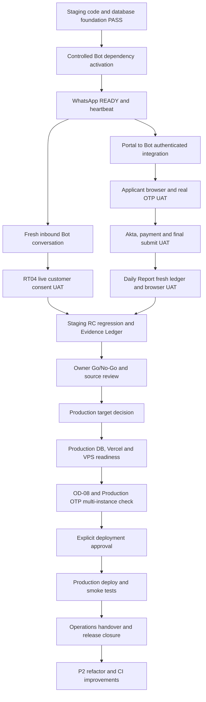

# KDJ Master Work Roadmap — 10 November 2026

**Scope authority:** KDJ Master System Specification v1.0 (approved; target scope frozen).  
**Worktrees:** Portal `C:\Users\umair\KDJ stagging\kdj-portal`; Bot `C:\Users\umair\KDJ stagging\kdj-wa-bot`.  
**Database:** Supabase Staging `pgmdurnylyuqkikbwwwy` / `kdj-staging-v6`.  
**Production:** Not changed. No deployment authorized by this roadmap.  
**Method:** KDJ Audit Protocol v2 — evidence-based, risk-based, change-driven. Re-test only where an environment/dependency/incident/impacted change makes existing evidence stale.

## 1. Executive disposition

**Current state: Staging implementation, Bot dependency activation and WhatsApp READY verification are complete; overall release is NOT READY.**

The remaining work is primarily inbound/Outbox integration UAT, applicant and RT04 live UAT, Daily Report coverage/UI verification, Production environment/infrastructure preparation, release packaging, and operations handover.

### Status legend

- **DONE** — evidence is recorded and remains valid for the current scope.
- **DONE / STAGING ONLY** — the Staging checkpoint passed; this does not imply Production readiness.
- **PARTIAL** — implementation or source remediation exists, but runtime activation or the required end-to-end proof remains.
- **OPEN** — test, decision, configuration, or deployment work remains.
- **WAITING OWNER / OPERATOR** — requires an explicit environment/target decision or a coordinated maintenance action.

## 2. Completed foundation — do not repeat without a trigger

| ID | Work package | Latest evidence / status |
|---|---|---|
| FND-01 | Master System Specification v1.0 and frozen target scope | **DONE** — new scope/business-rule changes require CR/CIR. |
| FND-02 | Portal authentication/session hardening | **DONE** — session identity tests and route protections recorded; retest only if impacted. |
| FND-03 | Scheduling V2 and booking constraints | **DONE / STAGING ONLY** — database tests and Admin-attested booking UAT recorded. |
| FND-04 | Booking Outbox and Bot notification flow | **DONE for previously tested outbound booking path** — one team-controlled WhatsApp send and provider acknowledgement recorded. |
| FND-05 | Admin-attested booking lane and legacy Staging bypass cutover | **DONE / STAGING ONLY** — positive/negative UAT and OD-08 Staging permission revoke recorded. |
| FND-06 | RT-04 database/service contracts | **DONE / STAGING ONLY — synthetic exact replay and negative contracts pass; controlled live SETUJU + second-pending BATAL passed. Dedicated non-Admin customer-controlled UAT and live exact replay remain release qualifications.** |
| FND-07 | Akta Kelahiran API/Storage contract | **DONE / STAGING ONLY** — upload/retrieval and missing-Akta negative checks passed; applicant browser UAT remains open. |
| FND-08 | Passport follow-up rule | **DONE in local/Staging source** — applicant upload blocked; deferred file goes directly to Admin Human's personal WhatsApp number, shared by Admin Human. |
| FND-09 | Daily Report API/RBAC contract | **DONE / STAGING ONLY** — Super Admin/Admin Konsultan allowed; unauthorized/no-session requests denied. New ledger coverage and UI UAT remain open after the Staging reset. |
| FND-10 | Durable OTP and shared throttling (P1 #4/#5) | **DONE / STAGING ONLY** — durable RPCs, cooldown/quota, HMAC identifiers, two-process concurrency and cleanup verified. Deployed Vercel environment parity remains open. |
| FND-11 | Local Portal/Bot Staging environment parity | **DONE at latest local check** - API key values match without disclosure; both projects point to the same Staging ref; loopback Bot URL responds; Portal-configured key passed the protected Bot middleware check. |
| FND-12 | Bot dependency vulnerability remediation | **DONE / STAGING ONLY** — main npm ci activated; Puppeteer v25 Chromium smoke, 14/14 Bot tests, baseline, 0-vulnerability audits and WhatsApp READY/heartbeat passed. |

Prior passing evidence is preserved. Do not re-run broad regression just because the roadmap was refreshed.

## 3. Phase 1 — Complete local Staging integration readiness

**Priority: P0.** This phase must precede the final Staging applicant/WhatsApp UAT.

| ID | Task | Current status | Exit evidence / Definition of Done |
|---|---|---|---|
| STG-01 | Review current Bot process and coordinate a maintenance window | **DONE** — pre-stop state checked, Outbox empty/no open incident, Chromium closed via Puppeteer Browser.close, LocalAuth profile preserved. |
| STG-02 | Activate remediated Bot dependencies | **DONE** — npm ci, explicit Puppeteer install-script approval and npm rebuild puppeteer completed; installed versions match lockfile. |
| STG-03 | Restore and verify WhatsApp readiness | **DONE / READY** — latest activated PID 25136, WhatsApp runtime 2.3000.1053925913, Bot/Supabase/WhatsApp heartbeat OK/READY after RT04 fix restart. |
| STG-04 | Verify authenticated Portal-to-Bot integration | **DONE** - Portal-configured key accepted by Bot middleware; safe invalid-payload check returned HTTP 400 INVALID_PAYLOAD, no WhatsApp message sent. |
| STG-05 | Verify fresh inbound Bot conversation | **PASS — limited live evidence** - controlled handset suffix 1604 produced CUSTOMER_INBOUND at 23:09:11 WIB and BOT_REPLY at 23:09:22 WIB; LID resolution succeeded. Lead qualification timed out on this message; chat reply still recorded. |
| STG-06 | Verify Outbox end-to-end after Bot activation | **PASS** - Admin-attested synthetic booking sent via Bot worker; BOOKING_CREATED and BOOKING_CANCELLED each SENT with provider_message_id, one attempt each; test booking final status Batal; no nonterminal Outbox rows. |

**Dependency order:** STG-01 -> STG-02 -> STG-03 -> STG-04/STG-05 -> STG-06.

## 4. Phase 2 — Close live Portal applicant and WhatsApp UAT

**Priority: P0.** Use a dedicated test applicant and a customer-controlled test number. Do not use an unrelated real applicant or fabricate customer consent.

| ID | Task | Current status | Exit evidence / Definition of Done |
|---|---|---|---|
| UAT-01 | Applicant browser: request OTP | **OPEN** | Browser request succeeds through local Staging Portal and real WhatsApp delivery is received by the controlled test handset. |
| UAT-02 | OTP abuse-control user experience | **PARTIAL: RPC/concurrency passed** | Verify 60-second cooldown and `Retry-After` response through the real route; test correct OTP, replay denial and failure lockout using a dedicated test identity. Do not lock a real Admin/customer account. |
| UAT-03 | Applicant login and biodata flow | **OPEN** | OTP verification creates/loads the correct applicant session; biodata saves and reloads under the same verified phone identity. |
| UAT-04 | Applicant document upload | **PARTIAL: API/Storage passed** | Browser verifies Akta Kelahiran upload, file type/size validation, private Storage and document list. Confirm applicant Passport upload remains blocked and Passport stays a deferred Admin Human handoff. |
| UAT-05 | Payment proof and final submission | **OPEN** | Applicant can submit valid proof and final-submit; missing mandatory Akta is rejected; final status persists; no unauthorized fields or documents can be injected. |
| UAT-06 | Final-submit Portal → Bot notification | **OPEN** | A successful Staging final-submit calls the protected Bot path; the expected notification is delivered and its result is recorded. |
| UAT-07 | RT-04 live customer consent | **PASS WITH FOLLOW-UP / STAGING ONLY** | Controlled Staging SETUJU created one booking + one SENT Outbox; second pending approval BATAL reached CANCELLED with zero booking. PREPARE calendar preflight defect is closed by migration 20261110172031. Exact provider-message replay remains automated-contract evidence; dedicated non-Admin customer-controlled UAT remains a release qualification. |
| UAT-08 | Admin Human Passport handoff operating check | **PARTIAL** | Confirm Admin Human gives their own receiving number directly to the applicant after registration; Bot never asks for or receives the Passport file. The operating channel remains outside automated Bot upload. |

**Dependency order:** STG-03/STG-04 before UAT-01; UAT-01 -> UAT-02 -> UAT-03 -> UAT-04 -> UAT-05 -> UAT-06. RT-04 UAT-07 depends on STG-03/STG-05 and a real customer-controlled test handset. UAT-08 can be verified alongside final registration handoff.

## 5. Phase 3 — Complete Daily Report UAT after the Staging reset

**Priority: P0 release gate for the approved report capability.** Report delivery remains manual and copy-only; no WhatsApp/email automation is authorized.

| ID | Task | Current status | Exit evidence / Definition of Done |
|---|---|---|---|
| RPT-01 | Establish new ledger coverage | **OPEN** | After Bot restart, a real controlled inbound event and Bot reply are recorded; first successful event defines the new coverage start. No historical backfill is allowed. |
| RPT-02 | Validate report counts and snapshots | **OPEN** | Compare report output to known controlled events; correctly label prospective coverage and live snapshots (HUMAN state, Safe Mode, heartbeat, Outbox/FU status). |
| RPT-03 | Browser UI and clipboard UAT | **OPEN** | Super Admin and Admin Konsultan can select a date, view and copy the report; Admin Verifikator and unauthenticated users remain denied. |
| RPT-04 | Confirm reporting scope and privacy | **DONE by design; verify in UAT** | Report contains operational counts/statuses only; no phone, applicant names, transcripts or customer-level content. No automated delivery. |

**Dependency order:** STG-03/STG-05 → RPT-01 → RPT-02/RPT-03.

## 6. Phase 4 — Staging release-candidate gate

**Priority: P0/P1.** Execute after impacted UAT and activation work above.

| ID | Task | Current status | Exit evidence / Definition of Done |
|---|---|---|---|
| RC-01 | Portal regression | **PARTIAL / refresh impacted tests only** | Run relevant Portal tests (including OTP, Akta, Daily Report, Admin RBAC/booking, session identity, scheduling); `npm run lint`; production `npm run build`. Current last recorded test scripts were 12/12 and lint 0 errors/5 existing image warnings; rebuild after final impacted changes. |
| RC-02 | Bot regression on activated dependency tree | **OPEN after npm ci** | `npm run check`, all 14 test scripts, security audit/signatures, runtime READY, inbound/outbound and RT04 impacted regression all pass. |
| RC-03 | Staging database and migration audit | **PARTIAL** | Reconfirm applied migration ledger, schema/function signatures, SECURITY DEFINER empty search_path, RLS, table grants and approved RPC EXECUTE. Keep Staging legacy booking bypass revoked. No blind policy/grant changes. |
| RC-04 | Secret and environment inventory | **PARTIAL** | Confirm local Portal/Bot Staging refs and API key parity; all required server-only keys exist and have consistent identifiers. Never print values. Reconfirm all app instances use the same `SESSION_SECRET`/fallback for HMAC throttle keys. |
| RC-05 | Change-control and source review | **OPEN** | Review each changed file, migration, test and CR/CIR individually. Confirm no scope drift from Master Spec v1.0. No broad `git add .`; exclude .env, logs, backups, session/cache and build output. |
| RC-06 | Evidence Ledger and Go/No-Go | **OPEN** | Every required item has requirement ID, method/command, result, hash/environment/date and status. Staging UAT owners approve. Overall RC cannot pass while any P0 release gate remains open. |
| RC-07 | Commit/push/Preview deployment | **WAITING EXPLICIT APPROVAL** | Only after user reviews the exact staged file list and authorizes each release action. Branch pushes can trigger Vercel Preview deployments; ensure Preview target is understood before push. |

## 7. Phase 5 — Production environment and infrastructure readiness

**Priority: P1 release prerequisite.** Do not start mutations until the owner chooses the intended Production target. The previous inventory found Vercel Preview/Production variables pointing to a legacy Supabase project reported INACTIVE; do not assume it is the correct target or silently replace it.

| ID | Task | Current status | Exit evidence / Definition of Done |
|---|---|---|---|
| PRD-01 | Owner decision: intended Production Supabase project | **WAITING OWNER** | Explicitly choose whether to recover the legacy project or provision/use a new Production project. Record project ref, owner and lifecycle. |
| PRD-02 | Provision and secure Production database | **OPEN after PRD-01** | Apply reviewed migrations in order; verify schema, RPC contracts, ACLs, RLS, storage bucket/private access, Admin/key custody and backups. Keep Staging and Production separate. |
| PRD-03 | Configure Vercel Preview and Production | **OPEN after PRD-01** | Correct Supabase project URL/keys and server-only SESSION_SECRET, Bot API endpoint/key, Admin booking HMAC key/key ID and any required environment-specific values; inspect values only through secret-safe metadata/checks. |
| PRD-04 | Provision Bot VPS/service | **OPEN / OWNER INFRA** | Create VPS only when deployment approved; harden SSH/firewall, runtime version, service account, persistent WhatsApp auth storage, process supervisor, logs, restart policy, health/heartbeat and backup. |
| PRD-05 | External Bot endpoint and TLS | **OPEN after PRD-04** | Configure a public HTTPS endpoint with TLS, ingress restrictions and API-key middleware. Local `127.0.0.1:3001` is not a Vercel-to-VPS Production endpoint. |
| PRD-06 | Production Bot credentials and HMAC parity | **OPEN after PRD-02/04** | Configure Supabase service access, Bot API key, RT-04 approval HMAC key/key ID, Daily Report HMAC key and required AI/provider credentials; compare derived key IDs/parity without exposing secrets. |
| PRD-07 | Re-run OD-08 caller and privilege inventory | **OPEN after PRD-02/04** | Include Vercel, future VPS process manager, cron, webhooks, workers and integrations. Prove Bot has no direct booking DML or unauthorized legacy RPC path; preserve attested RPC architecture. |
| PRD-08 | Production OTP multi-instance parity | **OPEN after PRD-03** | Verify every deployed Portal instance uses the same HMAC derivation secret and shared database state. Staging two-process test does not substitute for this. |
| PRD-09 | Domain/TLS, monitoring, backup and recovery | **OPEN** | Verify Portal domain/TLS, Bot health endpoint, heartbeat/incident alerts, log retention/redaction, database backup and restore drill, WhatsApp session recovery and runbook. |

## 8. Phase 6 — Production release and post-deployment validation

**Priority: release execution.** Requires completed Phase 4, Phase 5 and explicit deployment authorization.

| ID | Task | Current status | Exit evidence / Definition of Done |
|---|---|---|---|
| REL-01 | Final release approval | **WAITING OWNER** | Exact Portal commit, Bot commit, migration set, environment, target domain and rollback plan approved. |
| REL-02 | Apply Production database changes | **OPEN after approval** | Reviewed production migrations applied in order; ACL/RLS/health smoke tests pass. |
| REL-03 | Deploy Bot service | **OPEN after approval** | Reviewed Bot commit and clean dependency install active on VPS; service supervisor healthy; WhatsApp READY/heartbeat OK. |
| REL-04 | Deploy Portal | **OPEN after approval** | Approved Portal commit deployed to the intended Vercel Production project; environment target verified. |
| REL-05 | Production smoke tests | **OPEN after deployment** | Controlled Admin login, applicant OTP, secure document upload, final submission notification, Admin booking, Outbox delivery, report access and critical health checks pass using dedicated internal test identities. |
| REL-06 | Controlled operational observation | **OPEN after REL-05** | Monitor logs, incidents, heartbeat, provider send/ack and booking consistency during an owner-approved observation period; rollback if agreed thresholds are violated. |
| REL-07 | Release closure | **OPEN** | Final production evidence ledger, migration and commit hashes, environment inventory, rollback state and owner acceptance are recorded. |

## 9. Phase 7 — Documentation, operations handover and P2 improvement backlog

These tasks are not a reason to delay current Staging tests, but must be complete before long-term unsupported operation or scheduled as explicit post-release maintenance.

| ID | Task | Current status | Exit evidence / Definition of Done |
|---|---|---|---|
| OPS-01 | Portal README | **OPEN** | KDJ-specific setup, env variable names (not values), local/Staging modes, test/build commands, auth, migration and release process documented. |
| OPS-02 | Bot operations runbook | **OPEN** | Startup/shutdown, READY checks, heartbeat, WhatsApp session backup/restore, logs, incident recovery, npm ci, controlled update and rollback documented. |
| OPS-03 | Dependabot activation | **PARTIAL** | Bot .github/dependabot.yml exists locally; merge into default branch and enable Dependabot alerts/security updates in GitHub Settings. |
| OPS-04 | Repository release hygiene | **OPEN** | Review .gitignore, keep local dev logs out of release, exclude backups/session/cache/node_modules/.next and confirm artifact inventory. |
| OPS-05 | Admin/business handover | **OPEN** | Confirm who operates manual reports, customer Passport handoff, booking cancellation/recovery, incident escalation, Admin access and secrets custody. |
| OPS-06 | Optional structural refactor | **DEFERRED / P2** | Evaluate large Portal modules and Bot message-handler only as behavior-preserving CRs with dependency map, targeted tests and Evidence Ledger. No feature or business-rule changes. |
| OPS-07 | Test discoverability / CI | **DEFERRED / P2** | Consider one test:all entry point and CI after current release path is stable; keep external Gemini/live WhatsApp tests separately gated. |
| OPS-08 | Bot graceful shutdown lifecycle | **OPEN / P1 / CR-CIR REQUIRED** | Current SIGINT/SIGTERM handlers stop heartbeats only; a separate reviewed change should stop intake, await WhatsApp client/browser close, close the Express server, flush LocalAuth and exit cleanly without losing in-flight Outbox work. |

## 10. Master dependency map

## 11. Immediate next work queue

This is the execution order to use next, not a request to run all tasks at once:

1. **STG-01–04:** completed — dependency activation, WhatsApp READY/heartbeat and protected Portal-to-Bot middleware check are verified.
2. **UAT-07:** controlled Staging SETUJU and second-pending BATAL passed; PREPARE Scheduling V2 preflight fix is applied and verified. Exact same-provider-message replay remains automated-test evidence; dedicated customer-controlled UAT remains a release qualification.
3. **STG-05/STG-06:** completed — inbound/LID + Bot reply recorded; create and cancellation Outbox events SENT with provider IDs.
4. **UAT-01–06 and UAT-08:** retain existing OPEN/PARTIAL states; execute only the remaining scoped browser/hand-off tests.
5. **RPT-01–04:** establish new post-reset report coverage and finish browser/clipboard UAT.
6. **RC-01–07:** run impacted regression, DB/env/source review and Staging Go/No-Go.
7. **PRD-01 onward:** owner decides the Production Supabase target; then prepare Vercel, VPS, secrets, TLS, backup and monitoring.
8. **REL-01 onward:** deployment only after explicit approval; finish production smoke tests and operations handover.
9. **OPS-01–07:** close runbooks and schedule P2 maintenance/refactor/CI.

## 12. Release rules and stop conditions

- P0 live UAT must pass before Staging RC approval.
- A clean npm audit in an isolated Bot copy is not enough: the main installed graph and running process must be updated and verified during a controlled window.
- A local Staging environment pass does not prove Vercel Preview or Production environment parity.
- No Production migration, Vercel environment mutation, VPS deployment, commit, push, merge, or runtime restart without the appropriate owner approval.
- Any business rule, feature, API, schema, or architecture expansion outside Master Spec v1.0 requires a documented CR/CIR before implementation.
- Preserve passed evidence. Re-test only when evidence is stale, an environment/dependency changed, an incident occurred, or the changed code/dependency impacts that area.

## UAT-07 closure update — live BATAL verified; policy follow-up recorded (10 November 2026)

- Live second approval from controlled handset suffix 1604: approval `de8170ca-c705-4cc0-9d58-dfe371e20dff`, name `Bejo`, Offline, requested 14 November 2026 09:00 WIB.
- Inbound BATAL at 23:30:35.279 WIB; approval reached `CANCELLED` at 23:30:37.006 WIB; Bot reply event at 23:30:37.446 WIB.
- Cancellation row has no booking_id or notification_event_id; DB cross-check found zero booking rows for that approval.
- Earlier SETUJU request remains one `CONSUMED` approval → one `Terjadwal` booking → one `BOOKING_CREATED` Outbox event `SENT`. Exact same-provider-message replay is covered by automated RT04 contract tests, not repeated live.
- Global Staging Outbox: 3/3 SENT, 0 nonterminal/failed. Bot process, Supabase, and WhatsApp READY heartbeats OK; no open incidents.
- **Follow-up finding:** the cancelled request used Saturday 14 November (ISO weekday 6). `kdj_prepare_booking_approval` does not enforce weekday/working-hours/H-1/slot validation before sending its summary. `kdj_create_booking` enforces Monday–Friday, business hours and H-1 at finalization, so the invalid booking is still blocked at commit; however, an unbookable summary can reach the customer. Review a minimal correction under the existing frozen Scheduling V2 rules; do not expand business scope.
- The first SETUJU test booking remains `Terjadwal`; no Admin cleanup was executed. BATAL on the second pending approval must not cancel the first consumed booking.
- No source/schema/migration changes, commit, push, deployment, or Production activity.

**Disposition:** UAT-07 = **PASS WITH FOLLOW-UP / STAGING ONLY**. Overall Release Candidate remains **NOT READY** pending the independent applicant/browser, Daily Report UI, Production readiness, and dedicated non-Admin customer-controlled RT04 qualification. The PREPARE calendar-validation defect is closed by migration 20261110172031.

## RT04 PREPARE fix closure — 11 November 2026

- **Closed for Staging:** migration `20261110172031_rt04_prepare_schedule_policy_validation` enforces the existing Scheduling V2 calendar before the approval summary is sent.
- Live signed-RPC Staging tests passed: H-1 → `BOOKING_REQUIRES_PREVIOUS_DAY`; Saturday → `CLOSED_DAY`; 08:00 WIB → `OUTSIDE_WORKING_HOURS`; active-slot overlap → `SLOT_UNAVAILABLE`; valid Friday 10:00 WIB → `PREPARED`.
- Bot service and conversation response handling updated; Bot check, RT04 tests, and Scheduling V2/Outbox tests pass.
- Temporary positive-control approval and all HMAC test nonces were deleted; 0 test records remain. Booking count unchanged (2); Outbox 3 SENT / 0 nonterminal.
- Bot restarted after controlled Chromium close: final PID 25136, API 127.0.0.1:3001, WhatsApp Web 2.3000.1053925913 READY, Supabase heartbeat OK.
- Scope is existing approved Scheduling V2 policy only; no business rule or API signature expansion. Production untouched; no commit/push/deployment.
- Next stage is **not started**. Await owner approval before UAT applicant/OTP work.
